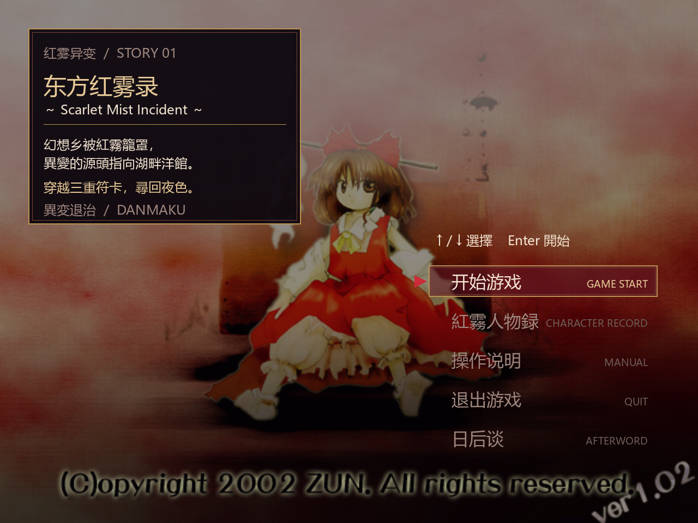
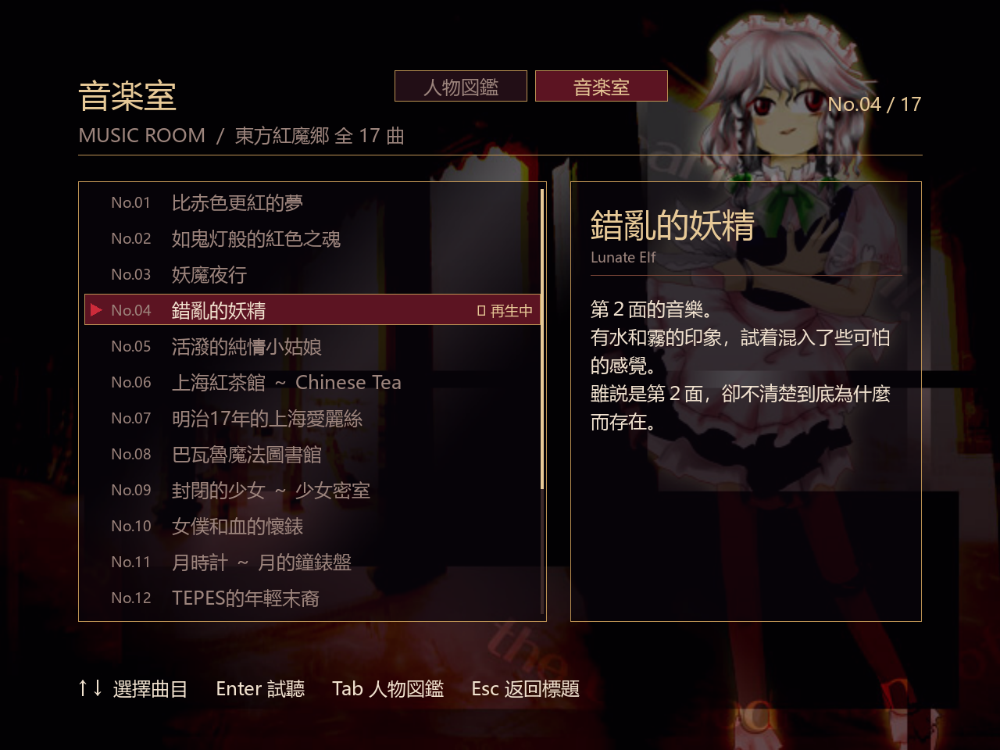
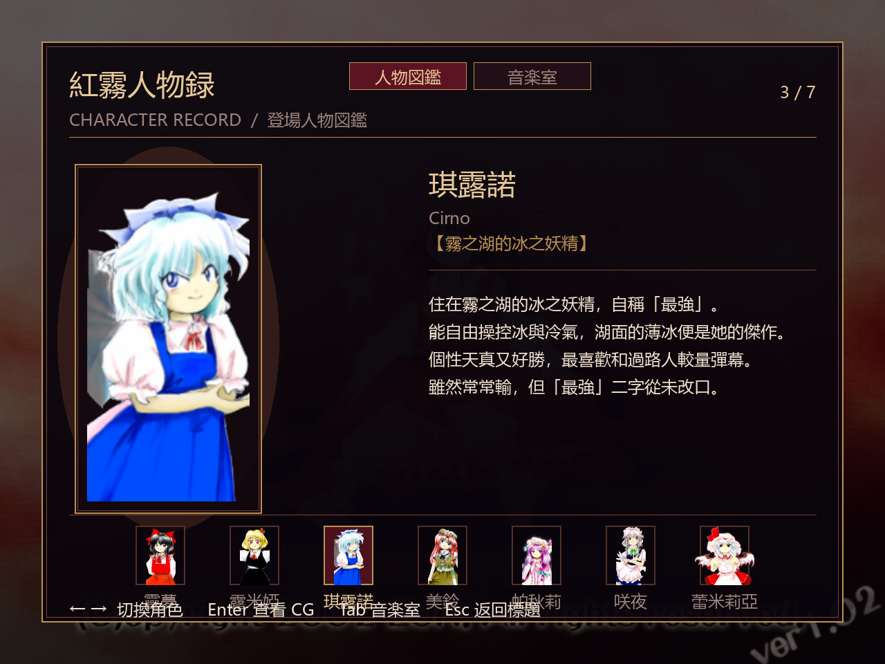

# 东方红雾录

**课程项目：问题求解大作业 · 四川大学计算机学院** ｜ 完成日期：2026-11 ｜ Python 3.12 · pygame-ce · PyInstaller · GitHub Actions

**验收信息：三关完整流程 · 173 项自动化测试通过**

> **素材版权说明**：东方Project相关素材版权归 ZUN / 上海爱丽丝幻乐团等各自权利人所有。本仓库的 MIT 许可仅适用于代码，不适用于游戏素材；来源与说明见下方「素材与许可」。

> 一款致敬《东方红魔乡》的 2D 弹幕射击游戏。用 Python + pygame-ce 从零实现碰撞检测、关卡状态机与数据驱动的符卡系统，三关完整流程可通关。

---

## 🎮 游戏截图

<p align="center">
  
  
</p>
<p align="center">
  
  
</p>
<p align="center">
  
</p>

## ✨ 特色

- **三关完整流程**：人里近郊 → 雾之湖 → 红魔馆，每关依次经过过场对话、杂兵波次、中 Boss、关底 Boss 与关卡结算，第三关为终局。
- **数据驱动的符卡系统**：扇形 / 环形 / 螺旋 / 散射四种发射器自由组合，每张符卡独立冷却与限时，贴近原作的「取得」判定（限时内无受击、无灵击才算取得）。
- **自研碰撞检测**：不依赖物理引擎，自行实现圆-圆、线段-圆扫掠与均匀空间网格，支持 F2 调试层可视化命中圆、擦弹圆与扫掠线段。
- **原作风味的 UI**：标题与音楽室直接复用红魔乡原作素材，菜单文字按原作「大字 + 红色光标」风格绘制；战斗采用 1280×960 横屏布局（左侧弹幕场、右侧信息栏），哥特描金边框 + 绯红页签。
- **人物录 / 背景図鑑 / 音楽室 / 日后谈**：通关后解锁 7 名角色立绘与台词浏览；「紅霧人物録」内设「人物図鑑」「背景図鑑」「音楽室」三个页籤，背景図鑑可翻阅三张关卡背景、四张结局图与六张原作结局插画等共 16 张整屏画面，音楽室收录原作全 17 曲的曲名与 ZUN 评论并可逐首试听；还有三页原作口吻的后记，以及配专属谢辞曲、自下而上滚动原作插画与制作名单的鸣谢页（滚完按 Enter 返回标题）。
- **跨平台打包**：CI 自动构建 Windows / Linux / macOS 可执行文件，开箱即玩。

## 🕹️ 操作

| 按键 | 功能 |
|---|---|
| ↑ ↓ / Enter | 标题菜单选择与确认 |
| ← → | 说明书翻页 / 人物图鑑 · 背景图鑑切换 |
| ↑ ↓ / Tab | 音楽室选曲 / 人物图鑑 · 背景图鑑 · 音楽室页籤切换 |
| 方向键 / WASD | 自机移动 |
| Shift | 低速移动（显示判定点） |
| Z | 射击（点按单发 / 按住连发） |
| X | 灵击（Bomb，消弹并短时无敌） |
| F1 | 暂停 / 继续 |
| F2 | 碰撞调试层 |
| F3 | 作弊（输入密码解锁无敌） |
| R | 结算后重新开始 |
| Esc | 返回标题 / 退出（标题页退出会先弹确认框） |

## 📥 下载

前往 [Releases](https://github.com/lyra-xuan/Touhou_Project/releases) 页面下载对应平台的可执行文件，解压后双击运行即可，无需安装 Python。

## 🛠️ 从源码运行

需要 Python 3.12。

```powershell
# 克隆仓库
git clone https://github.com/lyra-xuan/Touhou_Project.git
cd Touhou_Project

# 创建虚拟环境
py -3.12 -m venv .venv
.\.venv\Scripts\Activate.ps1

# 安装依赖
python -m pip install -r requirements.txt

# 运行
python main.py
```

运行测试：

```powershell
python -m unittest discover -s tests -v
```

## 📦 打包为可执行文件

```bash
pip install -r requirements-build.txt
bash build.sh
```

产物在 `dist/` 目录下。CI 配置见 [.github/workflows/build.yml](.github/workflows/build.yml)。

## 🚀 发版流程

1. 在 [.github/release-notes](.github/release-notes) 下按版本号新建说明文件（如 `v1.0.5.md`），先注明素材版权归属，再写本版的**新增功能**与**问题修复**。
2. 打 tag 并推送：

```bash
git tag -a v1.0.5 -m "东方红雾录 v1.0.5"
git push origin v1.0.5
```

3. CI 会在三平台构建，并把该说明文件作为 Release 正文发布；若未提供对应说明文件，则回退为自动生成的 changelog。

## 📁 项目结构

```text
main.py                 程序入口
src/
  config.py             窗口与玩法参数
  director.py           关卡推进状态机（过场/对话/波次/战斗/结算）
  stages.py             三关剧本与步骤数据
  waves.py              杂兵波次编队
  dialogue.py           立绘对话场景
  spells.py             发射器与符卡定义（数据驱动）
  entities.py           玩家、Boss、妖精、子弹、道具、特效
  collision.py          几何碰撞与空间网格
  art.py                背景、角色、弹幕、特效图片加载
  battle.py             战斗更新、碰撞、波次与道具逻辑
  hud.py                HUD 与战斗提示绘制
  render.py             菜单、结局与场景绘制
  audio.py              音效与背景音乐（失败时静默降级）
  game.py               输入分发、状态调度与主循环
assets/
  character/            自机、妖精、Boss 与立绘
  bullet/               弹幕图集与遮罩
  effect/               命中特效与技能光效
  scene/                关卡背景与结局插画
  title/                标题与菜单背景
  audio/ bgm/           音效与背景音乐（含来源说明）
  ATTRIBUTION.md        战斗美术素材来源与许可
tests/                  回归测试
docs/                   需求、制作指南、素材清单
.github/                CI 工作流与按版本号存放的发版说明
```

## 🧰 技术栈

- **Python 3.12** + **pygame-ce**（图形 / 输入 / 音频）
- 自研碰撞检测：圆-圆、AABB、线段-圆扫掠、均匀空间网格
- 数据驱动符卡：声明式 `Emitter` + `SpellCard` 组合
- 关卡状态机：`StageDirector` 驱动剧本步骤序列
- **PyInstaller** 单文件打包 + **GitHub Actions** 跨平台 CI

## 许可

### 代码

本仓库代码采用 MIT License，详见 [LICENSE](LICENSE)。

### 游戏素材

游戏中的东方Project角色、立绘、背景、弹幕、特效与音乐版权归 ZUN / 上海爱丽丝幻乐团等各自权利人所有，不属于上述 MIT 代码许可。其他素材也归其各自权利人所有。来源记录见：

- `assets/title/ATTRIBUTION.md`
- `assets/ATTRIBUTION.md`
- `assets/audio/ATTRIBUTION.md`
- `assets/bgm/ATTRIBUTION.md`

---

<p align="center">
  <sub>Made with ♥ — 东方红雾录 · Scarlet Mist Record</sub>
</p>
